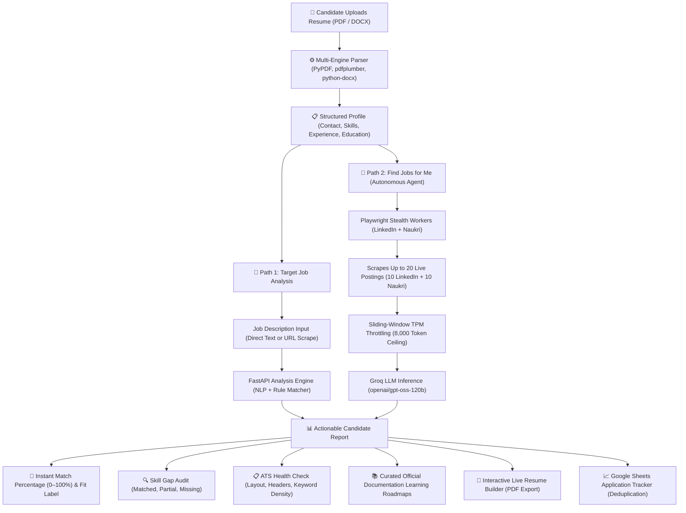

# ResumeMate 📄

A comprehensive full-stack platform that matches resumes against job descriptions, analyzes skill gaps, checks ATS compatibility, provides curated learning resources, features an interactive live resume builder, and includes an autonomous **Job Application Agent** to scrape and match opportunities across LinkedIn and Naukri — powered by FastAPI, PostgreSQL, Groq LLM, Playwright, and React 19.

[](https://react.dev/)
[](https://vitejs.dev/)
[](https://tailwindcss.com/)
[](https://fastapi.tiangolo.com/)
[](https://groq.com/)
[](https://www.postgresql.org/)
[](LICENSE)

---

## 🔄 How the Project Works (Detailed Walkthrough)

ResumeMate bridges the gap between candidate qualifications and recruiter expectations through an automated, intelligent 5-step pipeline:



### The 5 Core Workflows Explained Simply

#### 1. Resume Ingestion & Deep Text Parsing
- **The Problem:** Resumes come in dozens of different layouts (tables, two-column formats, PDFs generated by Canva, Word docs, LaTeX exports). Naive text extraction often scrambles sentences or loses contact info.
- **How ResumeMate Solves It:** The backend utilizes a multi-stage parser combining `pdfplumber` (for layout-aware text coordinate extraction), `PyPDF` (for metadata streams), and `python-docx` (for Word documents). 
- An NLP entity recognition engine cleans noise, isolates contact channels (email, phone, LinkedIn, GitHub), categorizes work experience, and identifies candidate technical skills against an expansive dictionary of 500+ programming languages, frameworks, cloud services, and developer tools.

#### 2. ATS (Applicant Tracking System) Compatibility Audit
- **The Problem:** Up to 75% of qualified resumes are rejected before a human recruiter sees them because automated ATS parsers fail to read non-standard headers, graphics, or fragmented contact details.
- **How ResumeMate Solves It:** ResumeMate audits candidate resumes across four critical ATS pillars:
  1. *Contact Information Completeness:* Verifies name, valid email, phone number, and professional profile links.
  2. *Section Header Legibility:* Confirms standard, machine-readable headers (e.g. `Work Experience`, `Education`, `Skills`).
  3. *Layout Parsability:* Flags complex multi-column floating boxes or unparsed symbols that trip up enterprise parsers.
  4. *Keyword Density:* Calculates the proportion of high-value industry terms and technical verbs.
- Delivers an overall **ATS Score (0–100)** with clear, actionable bullet points to improve parsability.

#### 3. Direct Job Match & Skill Gap Diagnosis
- **The Problem:** Candidates spend hours guessing why they don't hear back from specific job applications.
- **How ResumeMate Solves It:** When a candidate pastes a job description or job URL:
  - The system cross-references candidate skills against the job's must-have requirements and preferred qualifications.
  - Generates a categorized breakdown: **Matched Skills** (ready to highlight in interviews), **Partial Skills** (adjacent tools), and **Missing Skills** (critical gaps).
  - Every missing skill is paired with a **verified official documentation link** (e.g. React Docs, Docker Getting Started, AWS Guides) so candidates know exactly what to learn to qualify.

#### 4. Autonomous "Find Jobs for Me" Agent
- **The Problem:** Manually searching LinkedIn and Naukri, opening 50 tabs, reading long descriptions, and comparing them with your resume is tedious and exhausting.
- **How ResumeMate Solves It:**
  - With a single click, the autonomous agent launches background Playwright browser workers running in stealth mode with genuine browser footprints to bypass anti-bot shields (such as Akamai 403 on Naukri).
  - Simultaneously retrieves up to 10 live jobs from LinkedIn and 10 from Naukri in your chosen location (default: Bangalore, Karnataka).
  - **Prompt Compaction:** Strips out corporate filler (equal opportunity disclaimers, health benefits, recruiter boilerplate) and compacts the resume, slashing prompt tokens by >50%.
  - **Fast LLM Scoring:** Evaluates candidate fit via Groq's `openai/gpt-oss-120b` in under 1 second per job.
  - **TPM Protection & Caching:** A 60-second sliding-window token tracker paces requests within the 8,000 TPM limit, while a dual-layer disk cache stores results for instant sub-2ms retrievals on repeat searches.
  - **Live Transparency:** Streams all 9 discovery steps in real time via Server-Sent Events (SSE) right into the React dashboard.

#### 5. Live Resume Builder & Application Pipeline
- **Dual-Pane Builder:** Edit details on the left, watch the pixel-perfect resume preview update in real time on the right.
- **3 ATS-Optimized Templates:** Switch between *Modern*, *Classic*, and *Minimal* layouts designed strictly for readability and high ATS pass rates.
- **AI Writing Assistant:** Suggests strong action verbs and metric-driven bullet points (powered by Gemini AI).
- **Export & Track:** Export print-ready vector PDFs with one click, while qualified opportunities are automatically synced to your private Google Sheet for lifecycle tracking (`Applied`, `Interview`, `Offer`, `Rejected`).

---

## 💻 Technologies Used — What They Do & Why We Chose Them

Here is a breakdown of every major technology powering ResumeMate, explaining **what it does** and **why we chose it**:

```
┌─────────────────────────────────────────────────────────────────────────────────────────────┐
│                                     TECHNOLOGY ECOSYSTEM                                    │
├─────────────────────────┬─────────────────────────┬─────────────────────────────────────────┤
│ Frontend & User UI      │ React 19, Vite 8, Tailwind CSS, Lucide Icons                     │
│ Backend API & Core      │ FastAPI, Uvicorn, Asyncio, Pydantic v2, Python 3.11+            │
│ Database & Storage      │ PostgreSQL, SQLAlchemy 2 (Async), asyncpg, SQLite (Fallback)    │
│ AI Inference & LLM      │ Groq Cloud (openai/gpt-oss-120b), Google Gemini API             │
│ Scraping & Automation   │ Playwright (Chromium / Chrome Channel Stealth Mode)              │
│ Document Parsing        │ PyPDF, pdfplumber, python-docx                                   │
│ Cloud & Productivity    │ Google Sheets API (gspread), Server-Sent Events (SSE)           │
└─────────────────────────┴─────────────────────────┴─────────────────────────────────────────┘
```

### 1. Frontend & Client Experience

#### **React 19**
- **What it does:** Builds the interactive, component-based user interface across the Dashboard, Job Discovery, ATS Checker, and Resume Builder.
- **Why we chose it:** React 19's enhanced virtual DOM compiler and concurrent rendering provide instantaneous UI responsiveness. When a candidate types into the resume editor, updates filters, or sorts 20+ live job postings, re-renders happen at 60 FPS without stutter or page reloads.

#### **Vite 8**
- **What it does:** Serves as the modern frontend build tool and local development server.
- **Why we chose it:** Unlike legacy bundlers like Webpack, Vite leverages native browser ES modules (ESM) to provide near-instant cold server start times (<300ms) and lightning-fast Hot Module Replacement (HMR).

#### **Tailwind CSS 3.4**
- **What it does:** Provides utility-first styling for the entire application, featuring an editorial warm palette and seamless dark/light theme switching.
- **Why we chose it:** Eliminates bulky CSS stylesheets and naming conflicts. Generates only the styles used in production, keeping bundle sizes ultra-lean (~40KB gzip).

---

### 2. Backend & Asynchronous Architecture

#### **FastAPI + Uvicorn**
- **What it does:** Serves the high-speed Python REST API backend and handles real-time Server-Sent Events (SSE) streaming.
- **Why we chose it:** 
  - *Blazing Fast:* Built on Starlette and Pydantic, FastAPI is one of the fastest Python frameworks available, rivaling NodeJS and Go.
  - *Native Async Support:* Essential for handling background scrapers, LLM API calls, and streaming responses simultaneously without blocking other users.
  - *Auto-Generated Documentation:* Automatically creates interactive Swagger API documentation at `/docs` with strict schema validation out-of-the-box.

#### **PostgreSQL + SQLAlchemy 2 (with SQLite Fallback)**
- **What it does:** Persists candidate accounts, saved resumes, job postings, and match history.
- **Why we chose it:** PostgreSQL offers enterprise-grade reliability, relational data integrity, and high-performance asynchronous queries through `asyncpg`. We built an intelligent automatic fallback to SQLite so developers can run the entire system locally without needing a PostgreSQL server installed.

---

### 3. AI Engines & Rate-Limit Management

#### **Groq Cloud (`openai/gpt-oss-120b`)**
- **What it does:** Powers the core resume-to-job matching engine. Evaluates candidate fit, extracts experience requirements, and validates matched/missing skills against strict JSON schemas.
- **Why we chose it:** 
  - *Extreme Inference Speed:* Groq runs on custom LPUs (Language Processing Units) that achieve 300+ tokens per second. An evaluation that takes 6–10 seconds on traditional cloud LLMs completes in **under 1 second** on Groq.
  - *Structured Outputs:* Reliably delivers deterministic JSON formatting without conversational clutter or markdown hallucinations.

#### **Google Gemini API**
- **What it does:** Drives conversational resume advice, AI chat assistance, and dynamic bullet point rewriting in the Resume Builder.
- **Why we chose it:** Exceptional linguistic reasoning for transforming passive resume phrases into impactful, metric-driven achievements tailored to tech roles.

#### **Custom `TokenUsageTracker` (Sliding-Window Rate Limiter)**
- **What it does:** Monitors token consumption within a rolling 60-second window to prevent exceeding Groq's 8,000 Tokens Per Minute (TPM) quota.
- **Why we chose it:** Without throttling, batch-scoring 20 jobs would immediately trigger `HTTP 429 rate_limit_exceeded` errors. The tracker dynamically pauses execution right before the threshold and resumes as the sliding window replenishes.

#### **Dual-Layer Caching Engine (`_SCORING_CACHE` + Disk)**
- **What it does:** Caches successful job scoring results in memory and saves them to `.scoring_cache.json`.
- **Why we chose it:** Completely eliminates redundant LLM calls. If a user re-evaluates previously seen jobs, scores return in **<2ms at 0 token cost**, and only previously failed jobs are retried.

---

### 4. Scraping, Parsing & Cloud Synchronization

#### **Playwright (Chromium / Chrome Channel Stealth)**
- **What it does:** Automates headless browsers to search and scrape active job cards, locations, titles, and descriptions from LinkedIn and Naukri.
- **Why we chose it:** 
  - Modern web portals rely heavily on client-side JavaScript rendering and aggressive anti-bot detection (such as Akamai 403 blocks on Naukri).
  - Playwright with system Chrome channel scripts bypasses anti-bot heuristics where traditional scrapers (BeautifulSoup, Requests, Selenium) fail.

#### **PyPDF, pdfplumber & python-docx**
- **What it does:** Ingests candidate resumes in `.pdf` and `.docx` formats and extracts clean, layout-accurate text strings.
- **Why we chose it:** Having a layered fallback between `pdfplumber` (coordinate-based spatial extraction) and `PyPDF` (stream extraction) ensures resumes from Canva, Word, Google Docs, or LaTeX are parsed with maximum fidelity.

#### **Google Sheets API (`gspread`)**
- **What it does:** Automatically appends qualified job matches (match score $\ge 65\%$) to a private Google Sheet.
- **Why we chose it:** Gives candidates a portable, accessible job tracker they can view on mobile, annotate, and share with mentors without requiring a database frontend.

---

## ✨ Core Features

- 🎯 **AI Match Scoring:** Instant percentage match calculation between your resume and target job descriptions.
- 💼 **Find Jobs for Me (Autonomous Agent):** Automated live job search scraping up to 20 jobs from LinkedIn and Naukri, scored via Groq LLM (`openai/gpt-oss-120b`), with sliding-window TPM rate-limiting protection, dual-layer caching, and real-time 9-step Server-Sent Events (SSE) streaming.
- 🔍 **Skill Gap Analysis:** Categorized breakdown showing matched, partial, missing, and preferred technical skills.
- 📋 **ATS Checker:** Analyzes section headers, contact info integrity, layout parsability, and keyword density.
- 📚 **Official Documentation Guides:** Recommended study paths and curated official documentation links (React, Docker, AWS, PostgreSQL, etc.) for missing skills.
- 📝 **Live Resume Builder:** Interactive dual-pane editor with live preview, 3 ATS-friendly templates (_Modern_, _Classic_, _Minimal_), AI writing suggestions, and one-click **PDF Export**.
- 📄 **Resume Upload & Parsing:** Upload PDF or DOCX resumes with automatic skills, experience, and education extraction.
- 🔐 **Authentication:** JWT-based login & signup with secure password hashing (bcrypt).
- 📊 **Google Sheets & Pipeline Tracking:** Automatically logs matched opportunities to Google Sheets with MD5 deduplication.
- 🤖 **Gemini & Groq AI Integrations:** Dual-AI capability using Google Gemini for content optimization and Groq for high-speed job discovery matching.

---

## 🛠️ Detailed Tech Stack

### Frontend

| Layer       | Technology                            |
| :---------- | :------------------------------------ |
| Framework   | React 19, Vite 8, React Router 7     |
| Styling     | Tailwind CSS 3.4, Custom Warm Palette |
| Streaming   | Fetch API + Server-Sent Events (SSE)  |
| Icons       | Lucide React                          |
| Linter      | Oxlint                                |

### Backend (`backend/`)

| Layer       | Technology                                        |
| :---------- | :------------------------------------------------ |
| Framework   | FastAPI, Uvicorn (ASGI)                           |
| Database    | PostgreSQL (asyncpg) with SQLite fallback         |
| ORM         | SQLAlchemy 2 (async)                              |
| Auth        | JWT (PyJWT) + bcrypt                              |
| File Parse  | PyPDF, python-docx, pdfplumber                    |
| AI / LLM    | Google Gemini API (optional)                      |
| Validation  | Pydantic v2, email-validator                      |

### Job Application Agent (`job-application-agent/`)

| Layer             | Technology                                      |
| :---------------- | :---------------------------------------------- |
| Scraping Engine   | Playwright (Chromium / Chrome Channel Stealth)  |
| LLM Matcher       | Groq API (`openai/gpt-oss-120b`, `gpt-oss-20b`) |
| Rate-Limit Engine | Sliding-window `TokenUsageTracker` (8,000 TPM)  |
| Caching           | In-memory `_SCORING_CACHE` + `.scoring_cache.json`|
| Tracking & Export | Google Sheets API (`gspread`, Service Account)  |
| Analytics UI      | Streamlit, Altair                               |

---

## 🚀 Quick Start

### Prerequisites

- **Node.js** v18+ and **npm**
- **Python** 3.11+
- **Google Chrome** installed (for Playwright stealth mode)
- **PostgreSQL** 15+ _(optional — auto-falls back to SQLite)_

### 1. Clone the repository

```bash
git clone https://github.com/your-username/resume-matcher.git
cd "resume matcher"
```

### 2. Backend Setup

```bash
cd backend

# Create & activate virtual environment
python -m venv .venv
# Windows PowerShell:
.\.venv\Scripts\Activate.ps1
# macOS / Linux:
# source .venv/bin/activate

# Install dependencies
pip install -r requirements.txt

# Start backend server (port 8000)
python run.py
```

API docs will be available at **http://127.0.0.1:8000/docs**.

### 3. Job Application Agent Setup

```bash
cd ../job-application-agent

# Create & activate virtual environment
python -m venv venv
# Windows:
.\venv\Scripts\activate
# macOS / Linux:
# source venv/bin/activate

# Install dependencies and browser binaries
pip install -r requirements.txt
python -m playwright install chromium

# Copy and configure .env
cp .env.example .env
# Set your GROQ_API_KEY=gsk_...
```

To run a verification test on Groq matching, rate limiting, and scrapers:
```bash
python test_tpm_fix.py
```

### 4. Frontend Setup

```bash
cd ../Frontend

# Install dependencies
npm install

# Start Vite dev server
npm run dev
```

Open **http://localhost:5173** in your browser.

---

## ⚙️ Environment Variables

### Backend (`backend/.env`)

| Variable             | Description                                        | Default              |
| :------------------- | :------------------------------------------------- | :------------------- |
| `PROJECT_NAME`       | App name shown in API docs                         | `ResumeMate API`     |
| `PORT`               | Backend server port                                | `8000`               |
| `SECRET_KEY`         | JWT signing secret (**change in production**)      | —                    |
| `DATABASE_URL`       | Async DB URL (e.g. `postgresql+asyncpg://...`)     | —                    |
| `FALLBACK_TO_SQLITE` | Use SQLite if PostgreSQL is unavailable            | `True`               |
| `GEMINI_API_KEY`     | Google Gemini API key (optional)                   | —                    |

### Job Application Agent (`job-application-agent/.env`)

| Variable             | Description                                        | Default              |
| :------------------- | :------------------------------------------------- | :------------------- |
| `GROQ_API_KEY`       | Groq Cloud API key                                 | **Required**         |
| `GROQ_MODEL`         | Primary LLM model for resume matching              | `openai/gpt-oss-120b`|
| `GROQ_TPM_LIMIT`     | Tokens Per Minute ceiling for request throttling   | `8000`               |
| `GROQ_MAX_TOKENS`    | Output token limit per completion                  | `600`                |
| `GROQ_REQUEST_DELAY` | Sequential pause between requests (seconds)        | `1.5`                |
| `GROQ_MAX_RETRIES`   | Controlled retries on rate limits (429)            | `3`                  |
| `GOOGLE_SHEET_NAME`  | Google Sheets document name                        | `Job Applications`   |

---

## 📁 Project Structure

```plaintext
resume matcher/
├── Frontend/                       # React 19 single-page application
│   ├── src/
│   │   ├── components/             # Reusable UI (ATSChecker, ResumeUpload, JobRecommendations, etc.)
│   │   ├── context/                # AppContext & ThemeContext for global state
│   │   ├── data/                   # Mock data & sample templates
│   │   ├── pages/                  # Route views (Dashboard, Analyzer, Results, FindJobs, Builder)
│   │   ├── services/               # API client & SSE stream handler (api.js)
│   │   ├── App.jsx                 # Route configurations
│   │   └── main.jsx                # App entry point
│   ├── package.json
│   └── vite.config.js
│
├── backend/                        # FastAPI REST API
│   ├── app/
│   │   ├── models/                 # SQLAlchemy models (User, Resume, JobPosting)
│   │   ├── routers/                # API routes (auth, resumes, jobs, analyze, recommendations)
│   │   ├── schemas/                # Pydantic validation schemas
│   │   ├── services/               # Parsing, ATS analysis, skill extraction, recommendation
│   │   ├── config.py               # Backend settings
│   │   └── database.py             # Database session manager
│   ├── main.py                     # FastAPI application instance
│   ├── run.py                      # Server launcher
│   └── requirements.txt
│
├── job-application-agent/          # Autonomous Job Application Agent
│   ├── scraper/                    # Playwright scrapers for LinkedIn & Naukri
│   ├── matcher/                    # Groq LLM scoring, prompt compaction, TPM rate limiter
│   ├── tracker/                    # Models & Google Sheets sync (gspread)
│   ├── dashboard/                  # Streamlit metrics dashboard
│   ├── agent_service.py            # 9-Step SSE streaming service for Find Jobs
│   ├── config.py                   # Agent settings & model configurations
│   ├── main.py                     # CLI pipeline runner
│   ├── resume.txt                  # Plain text resume for CLI mode
│   └── test_tpm_fix.py             # Automated rate limiting & token compaction tests
│
└── README.md
```

---

## 🔌 Key API Endpoints

| Method | Endpoint                        | Description                                  |
| :----- | :------------------------------ | :------------------------------------------- |
| GET    | `/api/health`                   | System health & active database status       |
| POST   | `/api/auth/login`               | Authenticate user and issue JWT              |
| POST   | `/api/auth/signup`              | Register a new user account                  |
| POST   | `/api/resumes/upload`           | Upload & parse PDF/DOCX resume file          |
| POST   | `/api/analyze`                  | Full resume ↔ job match & ATS analysis       |
| POST   | `/api/recommendations/match`    | Match resume against multiple job postings   |
| POST   | `/api/recommendations/stream`   | Stream job recommendations with real-time SSE|
| POST   | `/api/agent/stream-jobs`        | Stream autonomous LinkedIn + Naukri discovery|
| GET    | `/api/dashboard`                | Retrieve candidate summary statistics        |

---

## 📜 Available Scripts

### Frontend (`Frontend/`)

```bash
npm run dev      # Launch React dev server (http://localhost:5173)
npm run build    # Production build
npm run preview  # Preview production build locally
npm run lint     # Lint using Oxlint
```

### Backend (`backend/`)

```bash
python run.py                   # Run FastAPI dev server with hot reload
python test_all_endpoints.py    # Run API endpoint test suite
```

### Job Application Agent (`job-application-agent/`)

```bash
python main.py                  # Run standalone scraping & scoring pipeline
streamlit run dashboard/app.py  # Launch Streamlit analytics dashboard
python test_tpm_fix.py          # Run TPM rate limiting & caching tests
```

---

## 📄 License

This project is licensed under the [MIT License](LICENSE).
