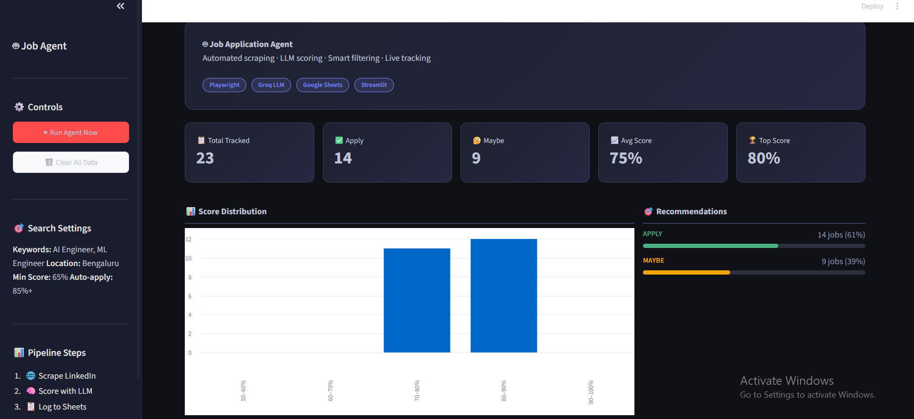
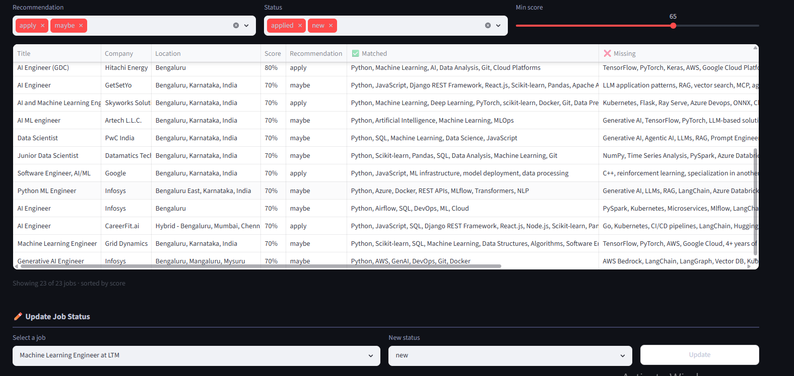

# Job Application Agent

An autonomous AI-powered job search assistant that scrapes job listings from LinkedIn and Naukri, scores them against your resume using an LLM, and tracks everything in Google Sheets — all with one command.

---

## Demo

### Dashboard


### Google Sheets Tracker


---

## How It Works

```
LinkedIn + Naukri          Groq LLM               Google Sheets
(Playwright scraper)  →  (Resume matcher)  →  (Live job tracker)
                               ↓
                        Streamlit Dashboard
                        (Metrics + filters + status updater)
```

1. **Scraper** — Playwright opens LinkedIn and Naukri, searches for AI/ML jobs in Bengaluru, extracts title, company, location, URL, and full job description
2. **Matcher** — Sends each JD + your resume to Groq's `openai/gpt-oss-120b` model, gets back a match score (0–1), matched skills, missing skills, and a recommendation (apply / maybe / skip)
3. **Filter** — Jobs below 65% match are discarded. Jobs above 85% are flagged for priority
4. **Tracker** — Passes filtered jobs to Google Sheets in a single batch write (deduplication built in)
5. **Dashboard** — Streamlit UI shows live metrics, score distribution chart, filterable job table, and a status updater

---

##  Features

-  **Multi-portal scraping** — LinkedIn + Naukri in one run
-  **LLM-powered scoring** — Resume vs JD match using Groq (llama-3.3-70b)
-  **Google Sheets tracker** — Live job pipeline with deduplication
-  **Streamlit dashboard** — Metrics, charts, filters, status updater
-  **Status management** — Update each job to `new / applied / interview / offer / rejected`
-  **Smart deduplication** — MD5 hash on URL prevents duplicate rows
-  **Clean architecture** — Separate modules for scraper, matcher, tracker, dashboard

---

##  Project Structure

```
job_agent/
├── scraper/
│   ├── __init__.py
│   ├── base_scraper.py       # Abstract base class
│   ├── linkedin_scraper.py   # LinkedIn Playwright scraper
│   └── naukri_scraper.py     # Naukri Playwright scraper
├── matcher/
│   ├── __init__.py
│   └── resume_matcher.py     # Groq LLM scoring logic
├── tracker/
│   ├── __init__.py
│   ├── models.py             # Job dataclass
│   └── sheets_tracker.py     # Google Sheets read/write
├── dashboard/
│   ├── __init__.py
│   ├── app.py                # Streamlit app (logic only)
│   ├── components.py         # Reusable UI components
│   └── styles.py             # CSS injection
├── config.py                 # Central config + env loader
├── main.py                   # Pipeline orchestrator
├── resume.txt                # Your resume in plain text
├── requirements.txt
└── .env                      # Secrets (never commit)
```

---

##  Tech Stack

| Layer | Technology |
|---|---|
| Browser automation | Playwright (Chromium) |
| LLM scoring | Groq API — openai/gpt-oss-120b |
| Job tracking | Google Sheets API (gspread) |
| Dashboard | Streamlit |
| Data model | Python dataclasses |
| Config | python-dotenv |

---

##  Setup

### 1. Clone the repo

```bash
git clone https://github.com/Keerthana-tech-26/job-application-agent.git
cd job-application-agent
```

### 2. Create virtual environment

```bash
python -m venv venv
venv\Scripts\activate        # Windows
source venv/bin/activate     # Mac/Linux
```

### 3. Install dependencies

```bash
pip install -r requirements.txt
python -m playwright install chromium
```

### 4. Set up environment variables

Create a `.env` file in the root:

```env
GROQ_API_KEY=your_groq_api_key
GMAIL_ADDRESS=your@gmail.com
GOOGLE_SHEET_NAME=Job Applications
```

### 5. Set up Google Sheets

- Create a Google Cloud project
- Enable **Google Sheets API** and **Google Drive API**
- Create a **Service Account** and download `credentials.json`
- Place `credentials.json` in the project root
- Create a Google Sheet named `Job Applications`
- Share the sheet with your service account email (Editor access)

### 6. Add your resume

Paste your resume as plain text into `resume.txt`

---

##  Usage

### Run the full pipeline

```bash
python main.py
```

This will:
- Scrape 10 jobs from LinkedIn + 10 from Naukri
- Score all 20 against your resume
- Log jobs above 65% match to Google Sheets

### Launch the dashboard

```bash
python -m streamlit run dashboard/app.py
```

Open `http://localhost:8501` in your browser.

---

##  Dashboard Features

| Feature | Description |
|---|---|
| Metrics row | Total tracked, apply count, maybe count, avg score, top score |
| Score distribution | Bar chart of jobs by score range |
| Recommendations | Visual breakdown of apply / maybe / skip |
| Job pipeline | Filterable table with clickable URLs |
| Status updater | Update any job's status with a dropdown |
| Run agent | Trigger full pipeline from the UI |
| Clear data | Reset the sheet from the UI |

---

##  Agent Decision Logic

```
Match score >= 85%  →  LOG with priority flag (apply immediately)
Match score 65–84%  →  LOG to sheet (review manually)
Match score < 65%   →  DISCARD (not a good fit)
```
---